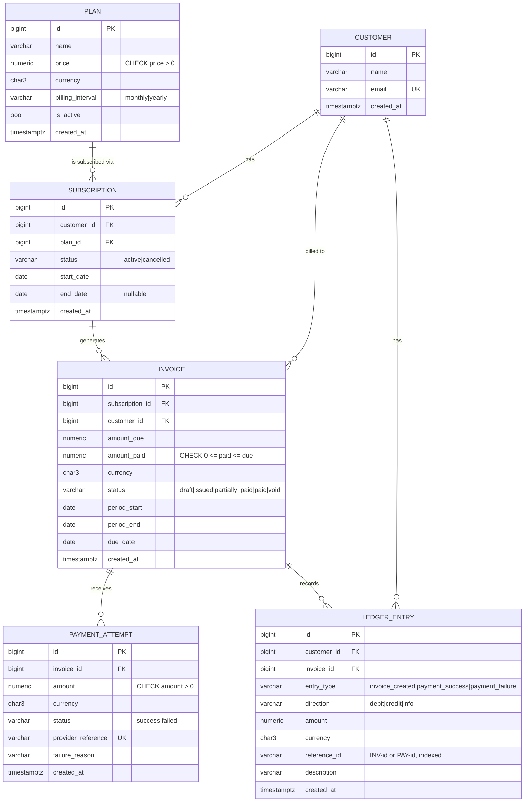
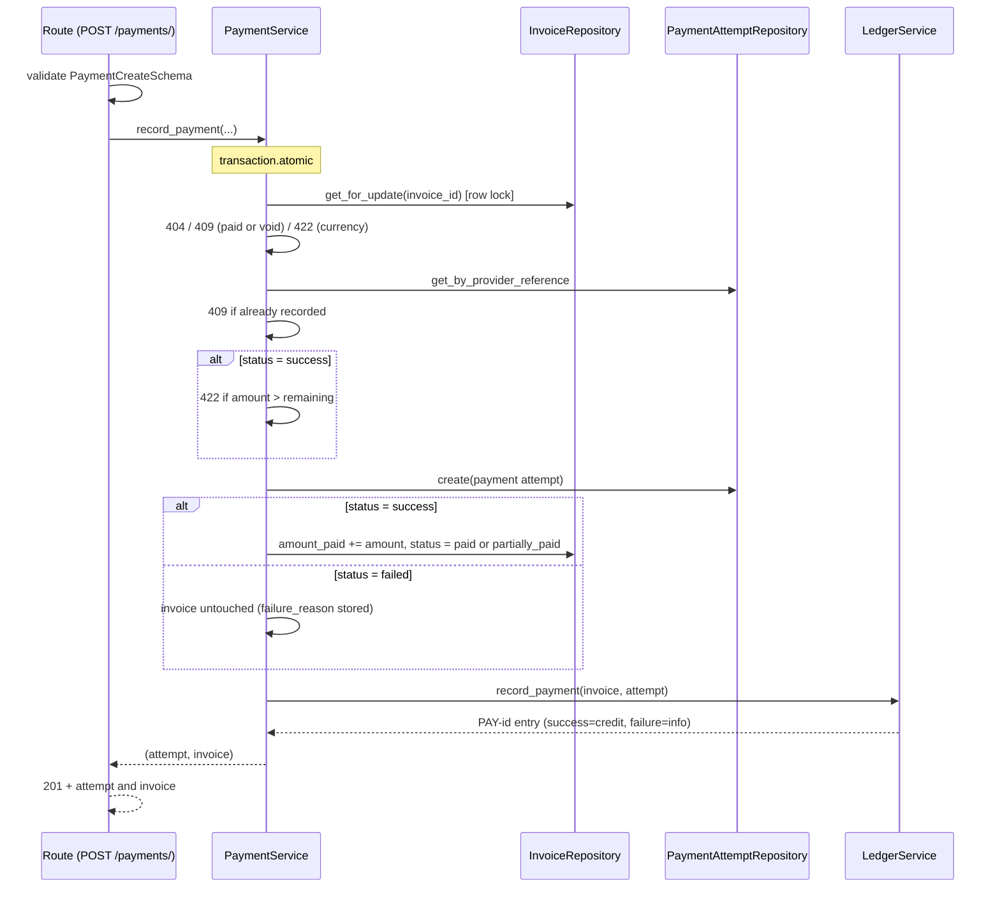

# SubLedger: High-Level and Low-Level Design

Stack: Python 3, Django 5, Django REST Framework, PostgreSQL.

---

# Part A: High-Level Design (HLD)

## A1. Goals and scope

SubLedger is a simplified billing backend that manages plans, customers, subscriptions, invoices, payment attempts and an append-only ledger.

**In scope:** the 12 REST endpoints and the business rules in the brief.
**Out of scope:** real payment gateways, taxes, proration, dunning, authentication, async jobs.

## A2. System context

```
 ┌──────────────┐   HTTPS/JSON    ┌───────────────────────────┐    SQL     ┌──────────────┐
 │ Client / Admin│ ─────────────▶ │  SubLedger API (Django)   │ ─────────▶ │ PostgreSQL   │
 │ UI, scripts   │ ◀───────────── │  gunicorn, stateless      │ ◀───────── │ (system of   │
 └──────────────┘                 └───────────────────────────┘            │  record)     │
                                              ▲                            └──────────────┘
 ┌──────────────┐  webhook/POST /payments     │
 │ Payment      │ ────────────────────────────┘
 │ provider     │  (provider_reference identifies each attempt)
 └──────────────┘
```

## A3. Logical architecture (layers)

```
   HTTP request
        │
        ▼
 ┌─────────────┐  validates shape/types with Schemas, no business logic
 │  Routes     │  billing/views.py + urls.py
 └─────┬───────┘
       ▼
 ┌─────────────┐  ALL business rules, transactions, orchestration
 │  Services   │  billing/services.py
 └─────┬───────┘
       ▼
 ┌─────────────┐  ONLY layer that uses the ORM; queries and persistence
 │ Repositories│  billing/repositories.py
 └─────┬───────┘
       ▼
 ┌─────────────┐  table structure + DB constraints (last line of defence)
 │  Models     │  billing/models.py  ──▶ PostgreSQL
 └─────────────┘

 Cross-cutting:  schemas.py (request/response), exceptions.py + exception_handler.py
                 (domain error → HTTP), container.py (dependency wiring), config/settings.py
```

**Dependency rule:** arrows only point downward. Services never import views; repositories never contain business rules; routes never touch the ORM.

## A4. Deployment view

* `docker-compose.yml` runs two containers: `web` (gunicorn + Django, runs migrations on start) and `db` (PostgreSQL 16 with a persistent volume).
* The API is stateless, so it can scale horizontally behind a load balancer. Correctness under concurrency comes from DB transactions, row locks and unique constraints rather than in-process state.

## A5. Key HLD decisions

| Decision | Reason |
|---|---|
| Layered architecture (Route → Service → Repository → Model) | Testable and extendable; satisfies the brief's separation requirement |
| PostgreSQL as the single source of truth | ACID transactions, row locks (`SELECT … FOR UPDATE`), partial unique indexes |
| `DecimalField` for money | Avoids floating-point errors |
| Ledger is append-only, enforced in model, queryset and repository | Auditability, with every entry traceable by `reference_id` |
| Rules enforced twice: service (friendly errors) and DB constraint (race safety) | Defence in depth |
| Domain exceptions mapped to HTTP in one handler | Services stay HTTP-agnostic |

---

# Part B: Low-Level Design (LLD)

## B1. ERD



### Fields added beyond the minimum, and why

| Field / constraint | Reason |
|---|---|
| `Plan.billing_interval`, `Plan.currency` | The invoice period and currency are derived from the plan |
| `Subscription.start_date/end_date` | Needed for the billing period and cancellation date |
| `PaymentAttempt.failure_reason` | The brief requires storing the failure reason |
| `LedgerEntry.direction` | Lets the customer balance be computed: debit = owed, credit = paid, info = no balance impact (failed payment) |
| Unique `(subscription, period_start, period_end)` on Invoice | Prevents double-billing the same period |
| Unique `provider_reference` on PaymentAttempt | Idempotency: a provider retry or webhook replay cannot double-count a payment |
| Partial unique `(customer, plan) WHERE status='active'` | DB enforcement of "no two active subscriptions to the same plan" |

## B2. Class and module responsibilities

### Services

| Service | Responsibility | Depends on |
|---|---|---|
| `PlanService` | Create and list plans; enforce price > 0 | PlanRepository |
| `CustomerService` | Create and read customers; enforce unique email | CustomerRepository |
| `SubscriptionService` | Create, read and cancel subscriptions; enforce inactive-plan and duplicate-active rules | SubscriptionRepository, CustomerRepository, PlanRepository |
| `InvoiceService` | Generate invoices: validate subscription, snapshot price, compute period, avoid duplicate period | SubscriptionRepository, PlanRepository, InvoiceRepository, LedgerService |
| `PaymentService` | Record payment attempts, update invoice amount and status, block overpayment | InvoiceRepository, PaymentAttemptRepository, LedgerService |
| `LedgerService` | Single writer of ledger entries; builds `reference_id` and direction | LedgerRepository |

### Repositories

| Repository | Methods | Notes |
|---|---|---|
| `PlanRepository` | `create, get, list` | |
| `CustomerRepository` | `create, get, get_by_email, list` | Case-insensitive email lookup |
| `SubscriptionRepository` | `create, get, get_for_update, has_active, list_for_customer, save` | `get_for_update` takes a row lock |
| `InvoiceRepository` | `create, get, get_for_update, exists_for_period, save` | `get_for_update` serialises concurrent payments |
| `PaymentAttemptRepository` | `create, get_by_provider_reference, list_for_invoice` | |
| `LedgerRepository` | `create, list_for_customer, list_for_invoice` | **No update or delete methods** |

### Routes (views)

Routes are thin. Each one runs `Schema(data=request.data).is_valid()`, calls one service method and serialises the result. There is no ORM access and no rule checking.

### Schemas

* Request schemas validate type and shape: positive decimal, valid email, enum choices.
* Response schemas control the exposed fields (`InvoiceSchema` adds a derived `remaining`).

## B3. Business-rule ownership

| # | Rule | Owner (primary) | Safety net |
|---|---|---|---|
| 1 | Plan price > 0 | `PlanService.create_plan`, with request schema `min_value` | DB `CHECK price > 0` |
| 2 | Customer email unique | `CustomerService.create_customer` (case-insensitive) | DB unique index |
| 3 | No subscription on inactive plan | `SubscriptionService.create_subscription` | none |
| 4 | No two active subscriptions to same plan | `SubscriptionService.create_subscription` | DB partial unique index |
| 5 | `amount_due` = plan price at generation time | `InvoiceService.generate_invoice` (copies `plan.price`) | none (a snapshot; later plan edits do not affect it) |
| 6 | Successful payment ≤ remaining | `PaymentService.record_payment` under row lock | DB `CHECK amount_paid <= amount_due` |
| 7 | Full payment → `paid`, partial → `partially_paid` | `PaymentService.record_payment` | none |
| 8 | Failed payment does not increase `amount_paid` | `PaymentService.record_payment` (invoice is only modified on success) | none |
| 9 | Ledger append-only and traceable | `LedgerService` and `LedgerRepository` (no mutators); `LedgerEntry.save/delete` and `AppendOnlyQuerySet.update/delete` raise | `reference_id` = `INV-<id>` / `PAY-<id>` |
| 10 | One invoice per subscription period | `InvoiceService.generate_invoice` | DB unique constraint |
| 11 | Idempotent payments (`provider_reference`) | `PaymentService.record_payment` | DB unique index |
| 12 | Payment currency matches invoice | `PaymentService.record_payment` | none |

## B4. Design patterns used

| Pattern | Where | Why |
|---|---|---|
| **Layered architecture** | whole app | Separation of concerns |
| **Repository** | `repositories.py` | Isolates the ORM; services can be tested with fakes and the persistence layer swapped |
| **Service layer** | `services.py` | One home for business rules and transaction boundaries |
| **Dependency Injection (constructor)** | services take repositories; wired in `container.py` (composition root) | Loose coupling, easy mocking |
| **Domain exceptions + central handler** | `exceptions.py`, `exception_handler.py` | Business code stays HTTP-agnostic; consistent error envelope |
| **Append-only log / event ledger** | `LedgerEntry` | Immutable audit trail |
| **Optimistic DB constraints + pessimistic row lock** | unique/check constraints plus `select_for_update` | Correct under concurrency |

## B5. Invoice generation flow

```mermaid
sequenceDiagram
    participant R as Route (POST /invoices/generate/)
    participant IS as InvoiceService
    participant SR as SubscriptionRepository
    participant IR as InvoiceRepository
    participant LS as LedgerService
    R->>R: validate InvoiceGenerateSchema
    R->>IS: generate_invoice(subscription_id, period?)
    Note over IS: transaction.atomic
    IS->>SR: get_for_update(subscription_id)
    SR-->>IS: subscription + plan
    IS->>IS: 404 if missing; 422 if not active
    IS->>IS: compute period (default: today + plan interval)
    IS->>IR: exists_for_period?
    IS->>IS: 409 if duplicate period
    IS->>IR: create(invoice, amount_due = plan.price, status=issued)
    IS->>LS: record_invoice_created(invoice)
    LS-->>IS: ledger entry (INV-id, debit)
    IS-->>R: invoice
    R-->>R: 201 + InvoiceSchema
```

Steps:
1. Route validates the body.
2. `InvoiceService` locks and fetches the subscription and its plan.
3. It checks that the subscription exists and is active.
4. It snapshots `plan.price` and `plan.currency` and computes the period and due date.
5. It rejects a duplicate period.
6. `InvoiceRepository` creates the invoice with status `issued`.
7. `LedgerService` writes an `invoice_created` debit entry with `reference_id = INV-<id>`.
8. Steps 2 to 7 commit in a single transaction, so there is never an invoice without a ledger entry.

## B6. Payment recording flow



Concurrency: two simultaneous payments on the same invoice serialise on the row lock, so the second one sees the updated `amount_paid` and cannot overpay. The DB check constraint is a second safeguard.

## B7. Error model

All errors use the shape `{"error": {"code": "...", "message": "..."}}`. Schema validation failures use DRF's default 400 field-error format.

| Exception | HTTP | Used for |
|---|---|---|
| `NotFoundError` | 404 | Missing customer, plan, subscription or invoice |
| `ConflictError` | 409 | Duplicate email, duplicate active subscription, duplicate invoice period, duplicate `provider_reference`, paying a paid invoice |
| `BusinessRuleViolation` | 422 | Inactive plan, overpayment, currency mismatch, invoicing a cancelled subscription |

## B8. API surface

Base path: `/api/v1`

| Method | Path | Purpose |
|---|---|---|
| POST / GET | `/plans/` | Create / list plans |
| POST / GET | `/customers/` | Create / list customers |
| GET | `/customers/{id}/` | Get a customer |
| GET | `/customers/{id}/subscriptions/` | List a customer's subscriptions |
| GET | `/customers/{id}/ledger/` | Customer ledger |
| POST | `/subscriptions/` | Create a subscription |
| GET | `/subscriptions/{id}/` | Get a subscription |
| POST | `/subscriptions/{id}/cancel/` | Cancel a subscription |
| POST | `/invoices/generate/` | Generate an invoice |
| GET | `/invoices/{id}/` | Get an invoice |
| GET | `/invoices/{id}/ledger/` | Ledger entries for an invoice |
| POST | `/payments/` | Record a payment attempt |

## B9. Invoice status state machine

```
 issued ──(partial success)──▶ partially_paid ──(remaining paid)──▶ paid
   │                                 │
   └──────────(full success)─────────┴──────────────────────────────▶ paid
 Failed payments never change status.   draft/void exist in the enum for extension.
```

## B10. Extension points

* Replace `PaymentService` input with a real gateway webhook adapter.
* Add a `void` or credit-note flow: new ledger `entry_type` values, with no changes to existing rows.
* Add authentication and multi-tenancy at the route and repository layers.
* Scheduled recurring invoicing: a management command or Celery task that calls `InvoiceService.generate_invoice`.
* Proration and refunds: new methods in the services, with new ledger entries.
